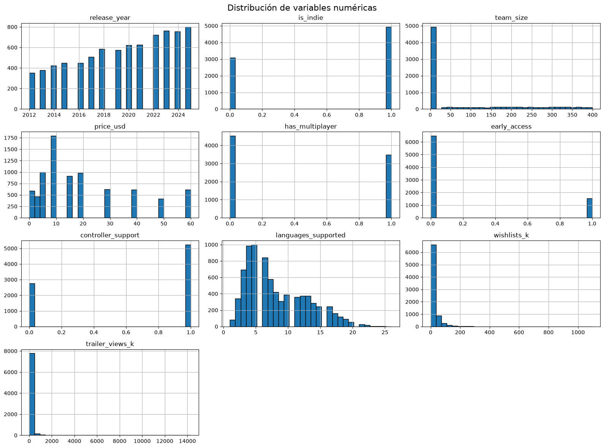
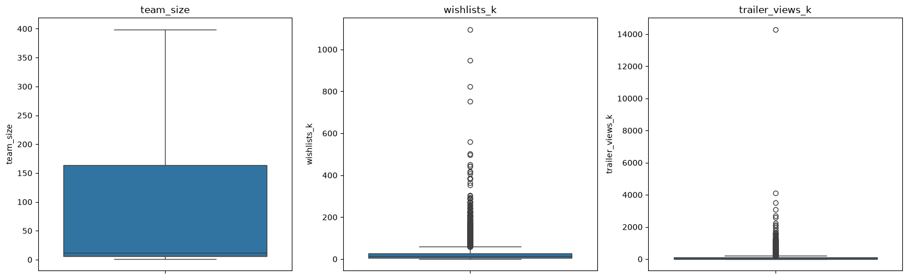
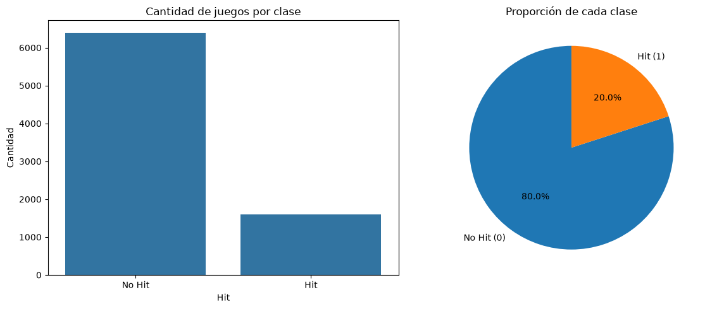
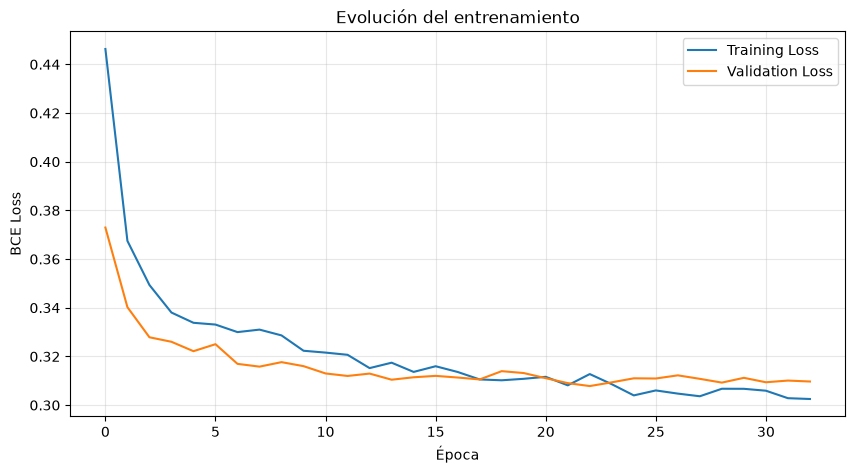
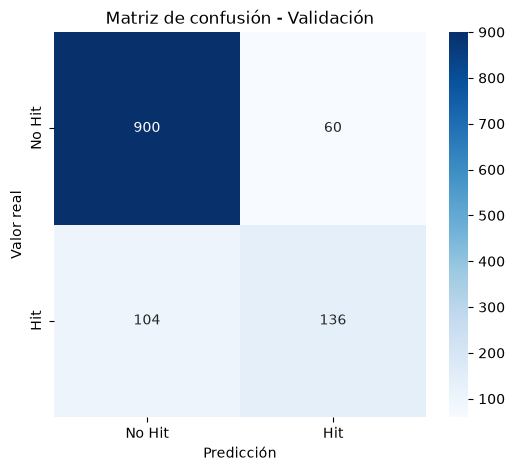
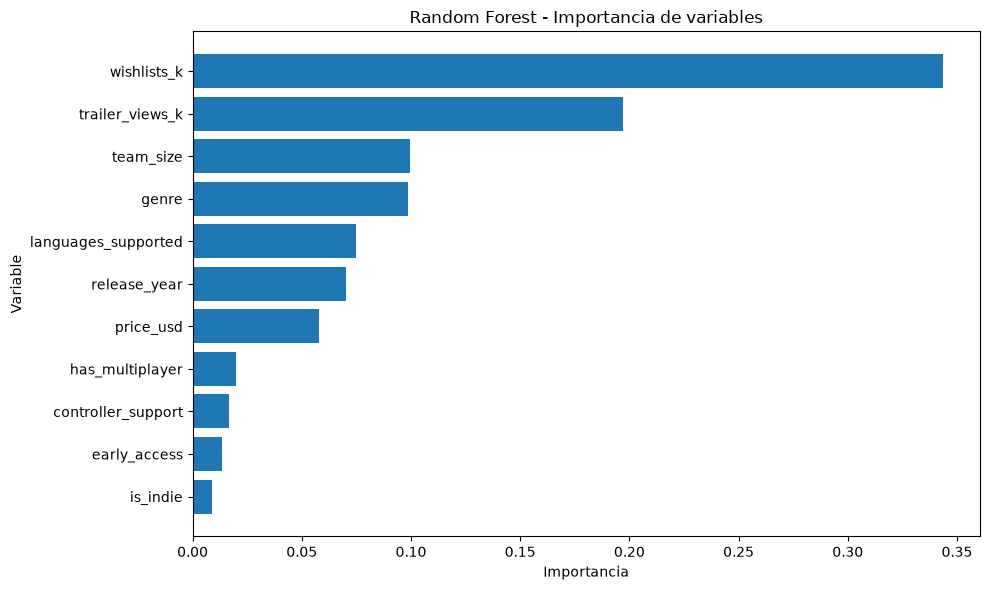
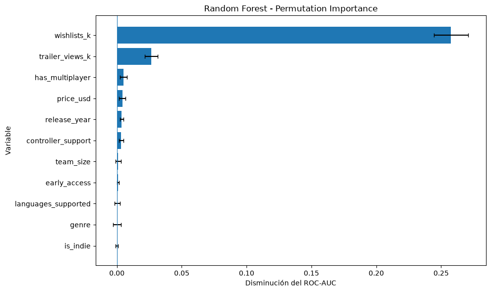

# Experimento 1 — Predicción del éxito comercial de videojuegos (`hit`)

**Documentación del proceso experimental · Versión baseline (en desarrollo)**

> **Estado del documento.** Este informe documenta el **primer experimento** de un trabajo de tres. Describe el recorrido realizado hasta ahora (decisiones, hipótesis, pruebas y resultados parciales) y **no** presenta una configuración final. Todas las métricas provienen del conjunto de **validation**; el conjunto de **test** permanece reservado y sin utilizar. Las secciones 9 y 10 se completarán a medida que avance la experimentación.

---

## Resumen del recorrido

| Etapa | Qué se hizo | Resultado clave | Qué decisión motivó |
| ----- | ----------- | --------------- | ------------------- |
| 1 | Selección de 11 variables y preparación de datos | Conjunto de variables "pre-lanzamiento" | Excluir variables que revelan el resultado |
| 2 | Análisis del desbalance (80/20) y partición estratificada | Relación 4:1 entre clases | No usar Accuracy como métrica principal |
| 3 | MLP con Entity Embedding para `genre` | ROC-AUC 0.8989, Recall 0.5667 @ 0.5 | Necesidad de referencias de comparación |
| 4 | Regresión Logística y Random Forest | RF con mejor AP; MLP con mejor F1 y ROC-AUC @ 0.5 | Los tres modelos detectan pocos Hit con umbral 0.5 |
| 5 | Experimentación con umbrales | Recall hasta 0.7625 con Precision ≥ 0.60 (RF) | Redefinir el objetivo práctico del sistema |
| 6 | Importancia de variables (impureza y permutación) | `wishlists_k` domina ampliamente | Hipótesis: se puede simplificar el modelo |
| 7 | Experimentos de reducción de variables (A–D) | Ninguna reducción mejoró de forma consistente | Mantener las 11 variables como baseline |
| 8 | Optimización de Random Forest | AP de validación cruzada = 0.6777; mejora moderada sobre el baseline | Conservar el modelo optimizado como candidato fina |
| 9 | Evaluación final sobre test | RF optimizado: F1 = 0.6385, Recall = 0.7250, ROC-AUC = 0.8875 | Seleccionar RF optimizado como modelo de referencia final |

---

## 1. Introducción

**Problema.** Predecir si un videojuego de Steam será un *hit* (`hit = 1`) o no (`hit = 0`) a partir de información que idealmente esté disponible **antes** del lanzamiento.

**Motivación.** Un sistema de este tipo serviría para priorizar proyectos o inversión de marketing. Por eso el interés práctico no está en acertar la clase mayoritaria, sino en **detectar la mayor cantidad posible de juegos exitosos sin generar demasiadas falsas alarmas**.

**Alcance de este documento.** Es el primer experimento (modelo de clasificación sobre datos tabulares) y sigue en desarrollo. El objetivo del informe es dejar registrado **cómo se llegó** a cada decisión, incluyendo las configuraciones que no resultaron ser las mejores, y no solamente la configuración que hoy rinde más.

---

## 2. Dataset

| Característica | Valor |
| -------------- | ----- |
| Archivo | `steam_game_hits.csv` |
| Registros (juegos) | 8.000 |
| Columnas | 22 |
| Valores nulos en las variables utilizadas | 0 |
| Variable objetivo | `hit` (binaria: 0 = No Hit, 1 = Hit) |

La variable objetivo no presenta valores nulos y sus únicos valores son 0 y 1.

---

## 3. Preparación de los datos

### 3.1 Selección de variables

**Objetivo.** Definir qué información puede usarse como entrada del modelo sin incurrir en fuga de información (*data leakage*).

**Decisión.** Utilizar **11 variables** para predecir `hit`, seleccionadas por su disponibilidad temporal (que representen información previa al lanzamiento) y su posible relación con el éxito comercial.

**Variables excluidas (11 de las 22 columnas):**

- **Identificadores y títulos:** `game_id`, `title`.
- **Resultados posteriores al lanzamiento:** `num_reviews`, `owners_k`, `peak_concurrent_players`.
- **Variable objetivo y revenue:** `hit`, `revenue_musd`.
- **Otras, descartadas para esta primera versión:** `dlc_count`, `file_size_gb`, `metacritic_score`, `steam_positive_pct`.

**Variables conservadas:**

| Tipo | Variables |
| ---- | --------- |
| Categórica | `genre` (12 categorías) |
| Numéricas | `release_year`, `team_size`, `price_usd`, `languages_supported`, `wishlists_k`, `trailer_views_k` |
| Binarias | `is_indie`, `has_multiplayer`, `early_access`, `controller_support` |

**Conclusión.** Se estableció un conjunto de características que intenta representar información disponible antes del lanzamiento, evitando usar directamente variables que revelarían el resultado comercial.

### 3.2 Exploración de las variables

**Objetivo.** Conocer la forma de las distribuciones para decidir el preprocesamiento.

**Estadísticas descriptivas relevantes (conjunto completo, 8.000 registros):**

| Variable | Media | Mediana | Mínimo | Máximo |
| -------- | ----- | ------- | ------ | ------ |
| `team_size` | 87.5 | 12 | 1 | 399 |
| `price_usd` | 19.80 | 14.99 | 0 | 59.99 |
| `languages_supported` | 8.08 | 7 | 1 | 26 |
| `wishlists_k` | 24.43 | 12.40 | 0.1 | 1095.9 |
| `trailer_views_k` | 93.07 | 38.70 | 0.3 | 14296.5 |

**Asimetría (skewness) de las variables:**

| Variable | Skewness |
| -------- | -------- |
| `trailer_views_k` | 30.317 |
| `wishlists_k` | 8.421 |
| `early_access` | 1.580 |
| `team_size` | 1.217 |
| `price_usd` | 1.049 |
| `languages_supported` | 0.763 |
| `has_multiplayer` | 0.265 |
| `release_year` | -0.309 |
| `is_indie` | -0.473 |
| `controller_support` | -0.652 |

**Figuras de referencia:**



*Figura 1. Histogramas de las variables. `wishlists_k` y `trailer_views_k` concentran casi todos los valores cerca de cero con colas extremadamente largas; `team_size` muestra una concentración en equipos pequeños y una distribución dispersa en equipos grandes.*



*Figura 2. Boxplots de las tres variables con mayor dispersión. `wishlists_k` y `trailer_views_k` presentan una gran cantidad de valores atípicos hacia arriba (hasta ≈1.100 y ≈14.300, respectivamente).*

**Decisión.** Aunque algunas variables tienen distribuciones muy asimétricas, **se mantuvieron los valores originales, sin transformaciones logarítmicas**, en esta primera versión.

**Conclusión.** La asimetría de `wishlists_k` y `trailer_views_k` queda como aspecto a considerar para modelos sensibles a la escala (MLP y Regresión Logística); en Random Forest no debería afectar, porque los árboles dependen del orden de los valores y no de su magnitud. 
<!--  *(Probar una transformación logarítmica queda como posible experimento futuro.)* -->

### 3.3 Preprocesamiento según el modelo

| Modelo | Numéricas | Binarias | `genre` |
| ------ | --------- | -------- | ------- |
| MLP | `StandardScaler` | sin modificar | Entity Embedding |
| Regresión Logística | `StandardScaler` | sin modificar | One-Hot Encoding |
| Random Forest | sin escalar | sin modificar | One-Hot Encoding |

Los transformadores se **ajustaron solamente con el conjunto de entrenamiento** y luego se aplicaron a validation y test, para evitar fuga de información. Para el MLP, el vocabulario de géneros también se construyó exclusivamente con train (12 géneros, con el índice 0 reservado para géneros desconocidos).

### 3.4 Desbalance de clases y particiones

**Objetivo.** Cuantificar el desbalance y definir una partición reproducible que lo respete.

| Clase | Registros | Proporción |
| ----- | --------- | ---------- |
| No Hit (0) | 6.400 | 80% |
| Hit (1) | 1.600 | 20% |

Relación No Hit / Hit = **4.00 : 1**.



*Figura 3. Cantidad y proporción de juegos por clase. Se observa el desbalance 80/20.*

**Procedimiento.** Partición **estratificada** 70 % / 15 % / 15 % (`random_state = 42`):

| Conjunto | Total | No Hit | Hit |
| -------- | ----- | ------ | --- |
| Train | 5.600 | 4.480 | 1.120 |
| Validation | 1.200 | 960 | 240 |
| Test | 1.200 | 960 | 240 |

**Conclusión.** Un modelo que predijera siempre "No Hit" lograría 80 % de Accuracy sin detectar ningún juego exitoso. Por eso se decidió **complementar Accuracy con otras métricas** (Balanced Accuracy, Precision, Recall, F1, ROC-AUC y Average Precision). El conjunto de test quedó **reservado para la evaluación final**.

---

## 4. Desarrollo del modelo neuronal (MLP + Entity Embedding)

**Objetivo.** Construir un modelo de deep learning para datos tabulares que aproveche la información de `genre` mediante una representación aprendida.

**Decisión de diseño.** En lugar de One-Hot Encoding, representar el género con un **Entity Embedding** de dimensión 6 que se concatena con las variables numéricas y binarias.

**Arquitectura:**

```
Entrada: 6 numéricas + 4 binarias (10) ‖ embedding de género (6)  →  16 valores

Embedding(13, 6, padding_idx=0)
Linear(16 → 64) → LayerNorm → GELU → Dropout(0.3)
Linear(64 → 32) → LayerNorm → GELU → Dropout(0.2)
Linear(32 → 1)  → logit
```

**Configuración de entrenamiento:**

| Parámetro | Valor |
| --------- | ----- |
| Función de pérdida | `BCEWithLogitsLoss` (sin pesos de clase) |
| Optimizador | AdamW (`lr = 0.001`, `weight_decay = 0.0001`) |
| Batch size | 64 |
| Épocas máximas | 100 |
| Early Stopping | paciencia = 10, sobre la pérdida de validation |
| Semilla | 42 |
| Hardware | GPU NVIDIA GeForce RTX 3080 (PyTorch 2.6.0 + CUDA 12.4) |

**Resultado del entrenamiento.** El Early Stopping detuvo el entrenamiento en la época 33 y se recuperaron los pesos de la **época 23**, con la mejor pérdida de validation: **0.30783**.



*Figura 4. Pérdida (BCE) de entrenamiento y validation por época. Ambas curvas descienden rápido durante las primeras épocas y la de validation se estabiliza cerca de 0.31, con una brecha pequeña respecto de train.*

### Evaluación inicial (validation, umbral 0.5)

| Métrica | Resultado |
| ------- | --------- |
| Accuracy | 0.8633 |
| Balanced Accuracy | 0.7521 |
| Precision | 0.6939 |
| Recall | 0.5667 |
| F1 | 0.6239 |
| ROC-AUC | 0.8989 |
| Average Precision | 0.6939 |



*Figura 5. Matriz de confusión del MLP (umbral 0.5): 900 verdaderos negativos, 60 falsos positivos, 104 falsos negativos y 136 verdaderos positivos.*

**Conclusión.** El MLP mostró buena capacidad para **distinguir** entre ambas clases (ROC-AUC ≈ 0.90), pero con el umbral convencional de 0.5 detecta solo el 56,7 % de los juegos Hit: se pierden 104 de los 240 Hit reales. Esto abrió la pregunta de si el problema estaba en el modelo o en el umbral (ver sección 6).

---

## 5. Modelos de referencia

**Objetivo.** Disponer de puntos de comparación para saber si la complejidad del MLP se justifica.

**Procedimiento.** Se implementaron dos modelos con las **mismas particiones y las mismas variables originales**, usando One-Hot Encoding para `genre`:

1. **Regresión Logística** (`max_iter = 2000`): baseline lineal.
2. **Random Forest** (`n_estimators = 300`, resto de parámetros por defecto): baseline basado en árboles.

### Resultados con umbral 0.5 (validation)

| Modelo | Accuracy | Balanced Acc. | Precision | Recall | F1 | ROC-AUC | AP |
| ------ | -------- | ------------- | --------- | ------ | -- | ------- | -- |
| Regresión Logística | 0.8608 | 0.7052 | **0.7589** | 0.4458 | 0.5617 | 0.8803 | 0.6858 |
| Random Forest | 0.8583 | 0.7193 | 0.7134 | 0.4875 | 0.5792 | 0.8957 | **0.6970** |
| MLP + Embedding | **0.8633** | **0.7521** | 0.6939 | **0.5667** | **0.6239** | **0.8989** | 0.6939 |

Matrices de confusión (filas = real, columnas = predicción; orden No Hit, Hit):

| Modelo | TN | FP | FN | TP |
| ------ | -- | -- | -- | -- |
| Regresión Logística | 926 | 34 | 133 | 107 |
| Random Forest | 913 | 47 | 123 | 117 |
| MLP + Embedding | 900 | 60 | 104 | 136 |

**Conclusión.** Con umbral 0.5, el MLP obtuvo el mejor F1, Recall, Balanced Accuracy y ROC-AUC; Random Forest tuvo el mejor Average Precision, y la Regresión Logística la mayor Precision (a costa de detectar menos Hit). Los tres modelos tienen dificultades para detectar los juegos Hit con el umbral predeterminado, y las diferencias de ROC-AUC entre ellos son pequeñas. Esto reforzó la idea de que **el umbral era una variable de decisión importante**.

---

## 6. Evaluación y selección de umbrales

Esta fue una de las etapas más importantes del proceso.

**Objetivo.** Entender cuánto cambia el desempeño al mover el umbral de clasificación y definir un criterio de selección alineado con el objetivo práctico.

**Hipótesis.** El umbral 0.5 no es necesariamente el más adecuado para un problema con 20 % de clase positiva; bajándolo, el Recall debería subir a cambio de menor Precision.

### 6.1 Barrido de umbrales

Se probaron umbrales entre 0.10 y 0.80 (paso 0.05) sobre validation. Ejemplo para el MLP:

| Threshold | Precision | Recall | F1 |
| --------- | --------- | ------ | -- |
| 0.10 | 0.4288 | 0.9292 | 0.5868 |
| 0.15 | 0.4665 | 0.9000 | 0.6145 |
| 0.20 | 0.4988 | 0.8375 | 0.6252 |
| 0.25 | 0.5222 | 0.7833 | 0.6267 |
| 0.30 | 0.5566 | 0.7375 | 0.6344 |
| 0.35 | 0.6036 | 0.7042 | 0.6500 |
| **0.40** | 0.6353 | 0.6750 | **0.6545** |
| 0.45 | 0.6623 | 0.6375 | 0.6497 |
| 0.50 | 0.6939 | 0.5667 | 0.6239 |
| 0.60 | 0.7286 | 0.4250 | 0.5368 |
| 0.70 | 0.7692 | 0.3333 | 0.4651 |
| 0.80 | 0.8448 | 0.2042 | 0.3289 |

Comparación de los tres modelos en umbrales seleccionados (Precision / Recall / F1):

| Threshold | Regresión Logística | Random Forest | MLP + Embedding |
| --------- | ------------------- | ------------- | --------------- |
| 0.20 | 0.5710 / 0.7375 / **0.6436** | 0.4734 / 0.8542 / 0.6092 | 0.4988 / 0.8375 / 0.6252 |
| 0.30 | 0.6432 / 0.6083 / 0.6253 | 0.6040 / 0.7625 / **0.6740** | 0.5566 / 0.7375 / 0.6344 |
| 0.40 | 0.7232 / 0.5333 / 0.6139 | 0.6652 / 0.6125 / 0.6377 | 0.6353 / 0.6750 / **0.6545** |
| 0.50 | 0.7589 / 0.4458 / 0.5617 | 0.7178 / 0.4875 / 0.5806 | 0.6939 / 0.5667 / 0.6239 |

**Mejor umbral por F1 de cada modelo:**

| Modelo | Threshold | Precision | Recall | F1 |
| ------ | --------- | --------- | ------ | -- |
| Regresión Logística | 0.20 | 0.5709 | 0.7375 | 0.6436 |
| Random Forest | 0.30 | 0.6040 | 0.7625 | **0.6740** |
| MLP + Embedding | 0.40 | 0.6353 | 0.6750 | 0.6545 |

**Conclusión parcial.** Bajar el umbral aumentó considerablemente el Recall en los tres modelos. Al optimizar el umbral, **Random Forest pasó a ser el modelo con mejor F1**, invirtiendo el orden observado con 0.5 (donde ganaba el MLP). Es decir: la comparación entre modelos depende fuertemente del punto de operación elegido.

### 6.2 Criterio de selección: maximizar Recall con una Precision mínima

Para evitar elegir el umbral solo por F1, se planteó una restricción experimental más cercana al uso práctico: **maximizar el Recall manteniendo una Precision mínima** (se evaluaron 0.60, 0.65 y 0.70).

| Modelo | Precision mínima | Threshold | Precision obtenida | Recall obtenido | F1 |
| ------ | ---------------- | --------- | ------------------ | --------------- | -- |
| Regresión Logística | 0.60 | 0.2316 | 0.6014 | 0.7042 | 0.6488 |
| Regresión Logística | 0.65 | 0.3040 | 0.6518 | 0.6083 | 0.6293 |
| Regresión Logística | 0.70 | 0.3781 | 0.7021 | 0.5500 | 0.6168 |
| **Random Forest** | **0.60** | **0.3033** | **0.6040** | **0.7625** | **0.6740** |
| Random Forest | 0.65 | 0.3833 | 0.6527 | 0.6500 | 0.6514 |
| Random Forest | 0.70 | 0.4600 | 0.7017 | 0.5292 | 0.6033 |
| MLP + Embedding | 0.60 | 0.3495 | 0.6014 | 0.7042 | 0.6488 |
| MLP + Embedding | 0.65 | 0.4164 | 0.6504 | 0.6667 | 0.6584 |
| MLP + Embedding | 0.70 | 0.5165 | 0.7021 | 0.5500 | 0.6168 |

**Conclusión.** Con la restricción de Precision ≥ 60 %, **Random Forest** logró el mejor resultado, detectando aproximadamente el **76,25 %** de los juegos Hit reales. Es un resultado que depende del nivel de Precision exigido: con 65 % el MLP queda levemente por encima en Recall (0.6667 vs 0.6500), y con 70 % la Regresión Logística y el MLP empatan por encima de Random Forest (0.5500 vs 0.5292). Esto permitió definir mejor el objetivo del sistema: **priorizar la identificación de posibles juegos exitosos sin aceptar una cantidad excesiva de falsos positivos**, tomando como referencia principal el criterio de Precision ≥ 60 %.

---

## 7. Interpretabilidad: importancia de variables

**Objetivo.** Entender qué variables sostienen las predicciones de Random Forest (el modelo que mejor rindió bajo el criterio de la sección 6.2) y detectar cuáles aportan poco.

Se aplicaron dos métodos con enfoques diferentes.

### 7.1 Importancia por reducción de impureza

Importancia nativa de Random Forest, sumando las categorías de `genre` en una sola variable.

| Variable | Importancia |
| -------- | ----------- |
| `wishlists_k` | 34.34 % |
| `trailer_views_k` | 19.72 % |
| `team_size` | 9.96 % |
| `genre` | 9.86 % |
| `languages_supported` | 7.46 % |
| `release_year` | 7.03 % |
| `price_usd` | 5.77 % |
| `has_multiplayer` | 1.97 % |
| `controller_support` | 1.67 % |
| `early_access` | 1.32 % |
| `is_indie` | 0.90 % |



*Figura 6. Importancia por reducción de impureza del Random Forest (variables agrupadas). `wishlists_k` y `trailer_views_k` concentran más de la mitad de la importancia total.*

### 7.2 Permutation Importance

Se midió cuánto disminuye el ROC-AUC (y el Average Precision) en validation al permutar aleatoriamente cada variable (20 repeticiones, `random_state = 42`).

| Variable | Caída del ROC-AUC | Desvío (ROC-AUC) | Caída del AP |
| -------- | ----------------- | ---------------- | ------------ |
| `wishlists_k` | 0.2576 | 0.0133 | 0.3941 |
| `trailer_views_k` | 0.0265 | 0.0050 | 0.0507 |
| `has_multiplayer` | 0.0051 | 0.0026 | 0.0121 |
| `price_usd` | 0.0042 | 0.0026 | 0.0004 |
| `release_year` | 0.0037 | 0.0015 | 0.0059 |
| `controller_support` | 0.0033 | 0.0017 | 0.0037 |
| `team_size` | 0.0011 | 0.0022 | 0.0051 |
| `early_access` | 0.0008 | 0.0007 | 0.0005 |
| `languages_supported` | 0.0002 | 0.0022 | -0.0010 |
| `genre` | 0.0002 | 0.0030 | -0.0040 |
| `is_indie` | -0.0000 | 0.0010 | 0.0016 |



*Figura 7. Disminución del ROC-AUC al permutar cada variable, con barras de desvío estándar. Para `team_size`, `languages_supported`, `genre` e `is_indie` el intervalo incluye el cero.*

### 7.3 Conclusiones y nueva hipótesis

- `wishlists_k` es, por una diferencia considerable, **la variable de mayor aporte predictivo** en el Random Forest evaluado (caída de 0.2576 en ROC-AUC al permutarla, frente a 0.0265 de la segunda).
- Los dos métodos **no coinciden** en todo: `genre` tiene una importancia de 9.86 % por impureza, pero una contribución individual prácticamente nula según Permutation Importance. Lo mismo ocurre, en menor medida, con `team_size` y `languages_supported`.
- Dado que varias variables aportan poco individualmente, surgió una **hipótesis nueva**: *quizás se pueda simplificar el modelo eliminando variables de poco aporte sin perder rendimiento.* Esta hipótesis se puso a prueba en la sección 8.

---

## 8. Experimentación con conjuntos de variables (feature ablation)

**Objetivo.** Comprobar si la hipótesis de la sección 7.3 es cierta: ¿se pierde rendimiento al quitar variables?

**Procedimiento.** Se reentrenó el mismo Random Forest (300 árboles, `random_state = 42`) con cuatro conjuntos de variables, manteniendo las mismas particiones.

| Experimento | Variables | Cantidad |
| ----------- | --------- | -------- |
| **A — Original** | Todas | 11 |
| **B — Sin género** | Todas menos `genre` | 10 |
| **C — Reducido** | Sin `genre`, `languages_supported`, `is_indie` y `early_access` | 7 |
| **D — Señales principales** | `wishlists_k`, `trailer_views_k`, `team_size`, `price_usd`, `release_year` | 5 |

### 8.1 Resultados con umbral 0.5

| Experimento | Vars. | Accuracy | Balanced Acc. | Precision | Recall | F1 | ROC-AUC | AP |
| ----------- | ----- | -------- | ------------- | --------- | ------ | -- | ------- | -- |
| C — Reducido | 7 | 0.8650 | 0.7406 | 0.7191 | 0.5333 | 0.6124 | **0.8984** | 0.6887 |
| A — Original | 11 | 0.8583 | 0.7193 | 0.7134 | 0.4875 | 0.5792 | 0.8957 | **0.6970** |
| B — Sin género | 10 | 0.8633 | 0.7349 | 0.7184 | 0.5208 | 0.6039 | 0.8957 | 0.6901 |
| D — Señales principales | 5 | 0.8650 | 0.7422 | 0.7167 | 0.5375 | **0.6143** | 0.8886 | 0.6796 |

Con umbral 0.5, el experimento C consiguió el mejor ROC-AUC (0.8984) y las versiones reducidas parecían mejores en F1 y Recall que la original. Esto, a primera vista, **confirmaba** la hipótesis de simplificación.

### 8.2 Resultados con umbral optimizado

Como la sección 6 había mostrado que el umbral cambia el ranking de modelos, se repitió la comparación optimizando el umbral para cada experimento.

**Criterio principal: máximo Recall con Precision ≥ 0.60**

| Experimento | Threshold | Precision | Recall | F1 |
| ----------- | --------- | --------- | ------ | -- |
| **A — Original** | 0.3033 | 0.6040 | **0.7625** | **0.6740** |
| B — Sin género | 0.3467 | 0.6014 | 0.7042 | 0.6488 |
| C — Reducido | 0.3667 | 0.6000 | 0.6625 | 0.6297 |
| D — Señales principales | 0.3333 | 0.6085 | 0.7125 | 0.6564 |

**Criterio complementario: máximo F1**

| Experimento | Threshold | Precision | Recall | F1 |
| ----------- | --------- | --------- | ------ | -- |
| **A — Original** | 0.3300 | 0.6263 | 0.7333 | **0.6756** |
| D — Señales principales | 0.3667 | 0.6445 | 0.6875 | 0.6653 |
| B — Sin género | 0.3367 | 0.5925 | 0.7208 | 0.6504 |
| C — Reducido | 0.2667 | 0.5455 | 0.8000 | 0.6486 |

### 8.3 Conclusión

- **Eliminar variables no produjo una mejora consistente.** Con el umbral por defecto parecía que simplificar ayudaba, pero al optimizar el umbral el **modelo original (A)** obtuvo el mejor equilibrio bajo ambos criterios.
- Esto muestra que una variable con **baja importancia individual puede aportar información complementaria** cuando se combina con otras; "poca importancia por permutación" no equivale a "prescindible".
- La inversión de resultados entre 8.1 y 8.2 refuerza una lección metodológica del proceso: **comparar configuraciones con un único umbral fijo puede llevar a conclusiones engañosas.**
- Las diferencias entre configuraciones son moderadas y provienen de **una sola partición y una sola semilla**, por lo que no deben interpretarse como diferencias estadísticamente establecidas.

**Decisión.** Mantener las **11 variables originales** como configuración de referencia (baseline) para las siguientes etapas.

---

## 9. Optimización de modelos

### 9.1 Estrategia de trabajo

Antes de realizar la optimización, se establecieron las siguientes decisiones para preservar la reproducibilidad de los experimentos:

1. **Congelar esta etapa como primera versión experimental (baseline)** y no modificar el entrenamiento original.
2. **No sobrescribir los objetos existentes** (`logistic_model`, `rf_model`, `rf_experiment_models`). Los nuevos modelos utilizarán nombres propios, como `rf_tuned_model`, `rf_tuned_results` y `rf_tuned_best_params`.
3. **Conservar los resultados y configuraciones experimentales**, incluyendo las variables utilizadas, los hiperparámetros y las semillas aleatorias.
4. Mantener separados los modelos originales y los modelos optimizados, de manera que sea posible comparar sus resultados sin perder las referencias anteriores.

### 9.2 Primer experimento de optimización: Random Forest

Se decidió comenzar la optimización con Random Forest, utilizando la configuración original de 11 variables como referencia.

| Elemento | Configuración |
| -------- | ------------- |
| Variables | Las 11 originales |
| Validación | Validación cruzada estratificada sobre train |
| Búsqueda de hiperparámetros | `RandomizedSearchCV` |
| Cantidad de combinaciones | 30 |
| Número de folds | 3 |
| Criterio de selección | Average Precision |
| Evaluación del modelo elegido | Sobre validation |
| Selección del umbral | Sobre validation |
| Test | Reservado para la comparación final |

Se eligió Average Precision como métrica de selección debido al desbalance de clases y al interés en evaluar la capacidad del modelo para identificar correctamente los ejemplos positivos.

### 9.3 Advertencia metodológica

En las etapas anteriores se probaron distintas configuraciones de modelos, conjuntos de variables y umbrales sobre el mismo conjunto de validation. Aunque el conjunto de test todavía no se había utilizado, las decisiones experimentales fueron adaptándose parcialmente a los resultados de validation.

Por este motivo, las métricas obtenidas durante esas etapas deben interpretarse como resultados de desarrollo y selección, y no como estimaciones completamente independientes del rendimiento.

La validación cruzada realizada durante la optimización permitió seleccionar los hiperparámetros utilizando exclusivamente el conjunto de entrenamiento. Posteriormente, validation se utilizó para evaluar el modelo seleccionado y determinar su umbral de clasificación.

El conjunto de test permaneció reservado para la evaluación final, sin intervenir en la selección de modelos, hiperparámetros ni umbrales.

### 9.4 Resultados de la optimización de Random Forest

**Objetivo.** Comprobar si la optimización de hiperparámetros permite mejorar el rendimiento del Random Forest original, manteniendo las 11 variables seleccionadas.

**Procedimiento.** Se utilizó `RandomizedSearchCV` para evaluar 30 combinaciones de hiperparámetros mediante validación cruzada estratificada de 3 particiones sobre el conjunto de entrenamiento. La métrica utilizada para seleccionar la mejor configuración fue Average Precision.

#### Mejores hiperparámetros encontrados

| Hiperparámetro | Valor seleccionado |
| -------------- | ------------------ |
| `n_estimators` | 300 |
| `max_depth` | `None` |
| `min_samples_split` | 20 |
| `min_samples_leaf` | 8 |
| `max_features` | `sqrt` |
| `class_weight` | `None` |
| `max_samples` | 0.85 |

El mejor Average Precision medio obtenido durante la validación cruzada fue **0.6777**.

#### Evaluación sobre validation

Una vez seleccionada la configuración, se evaluó el mejor estimador sobre `X_val`, utilizando inicialmente el umbral convencional de 0.5.

| Métrica | RF baseline | RF optimizado |
| -------------- | ----- | ------------ |
| Accuracy | 0.8583 | 0.8617 |
| Balanced Accuracy | 0.7193 | 0.7120 |
| Precision | 0.7134 | 0.7500 |
| Recall | 0.4875 | 0.4625 |
| F1 | 0.5792 | 0.5722 |
| ROC-AUC | 0.8957 | 0.8999 |
| Average Precision | 0.6970 | 0.7173 |

La optimización produjo mejoras en ROC-AUC y Average Precision, lo que indica una mejor capacidad para ordenar los ejemplos según su probabilidad de pertenecer a la clase positiva.

Sin embargo, con el umbral de 0.5 disminuyeron Recall y F1. Esto significa que, aunque el modelo optimizado mejoró su capacidad de discriminación, identificó una menor proporción de juegos exitosos al utilizar el umbral convencional.

Por lo tanto, se decidió analizar por separado la selección de hiperparámetros y el umbral de decisión.

#### Selección del umbral de decisión

Se aplicaron los criterios utilizados en los experimentos anteriores:

- **Criterio principal:** maximizar Recall manteniendo Precision ≥ 0.60.
- **Criterio complementario:** maximizar F1.

Los resultados del barrido de umbrales fueron:

| Criterio | Threshold | Precision | Recall | F1 |
| -------- | --------- | --------- | ------ | -- |
| Máximo Recall con Precision ≥ 0.60 | 0.290598 | 0.6006 | 0.7708 | 0.6752 |
| Máximo F1 | 0.292177 | 0.6086 | 0.7708 | 0.6801 |

Se seleccionó como umbral principal **0.29059821131498603**, porque responde al objetivo de detectar la mayor cantidad posible de juegos exitosos manteniendo una Precision mínima de 0.60 durante la selección sobre validation.

El umbral **0.2921768217278801** quedó registrado como alternativa cuando se prioriza maximizar F1.

Al aplicar el umbral principal sobre validation se obtuvo la siguiente matriz de confusión:

| | Predicción No Hit | Predicción Hit |
| -- | --------------: | ------------: |
| Real No Hit | 838 | 122 |
| Real Hit | 55 | 185 |

El modelo identificó correctamente 185 de los 240 juegos Hit, equivalente a un Recall de 0.7708. Al mismo tiempo, clasificó incorrectamente 122 juegos No Hit como Hit.

El reporte de clasificación obtenido fue:

| Métrica | No Hit | Hit |
| ------- | ------ | --- |
| Precision | 0.9384 | 0.6026 |
| Recall | 0.8729 | 0.7708 |
| F1 | 0.9045 | 0.6764 |

La Precision de la clase positiva se mantuvo por encima del mínimo establecido. El incremento de falsos positivos representa el costo de conseguir una mayor detección de juegos exitosos.

**Nota metodológica:** los valores de la tabla de búsqueda de umbrales corresponden al punto seleccionado en la curva Precision-Recall. El reporte de clasificación y la matriz de confusión corresponden a la aplicación del umbral redondeado a cuatro decimales. Por este motivo, los valores pueden presentar pequeñas diferencias. Para reproducir la evaluación final se conservó el umbral completo: `0.29059821131498603`.

#### Comparación con el Random Forest baseline

La comparación bajo los criterios de selección de umbral muestra las siguientes diferencias:

| Métrica | RF baseline | RF optimizado |
| ------- | ----------- | ------------- |
| Average Precision con threshold 0.5 | 0.6970 | 0.7173 |
| ROC-AUC con threshold 0.5 | 0.8957 | 0.8999 |
| Recall con Precision ≥ 0.60 | 0.7625 | 0.7708 |
| F1 con Precision ≥ 0.60 | 0.6740 | 0.6752 |
| Máximo F1 | 0.6756 | 0.6801 |

La optimización produjo mejoras moderadas en las métricas de ranking y en los resultados obtenidos mediante la selección del umbral. Sin embargo, las diferencias frente al modelo original no son grandes.

Esto indica que la búsqueda de hiperparámetros permitió obtener una configuración ligeramente mejor para el objetivo del problema, pero no produjo una mejora radical del rendimiento.

**Decisión.** Conservar el Random Forest optimizado como candidato principal para la evaluación final, manteniendo el Random Forest original como referencia. Se estableció como umbral principal `0.29059821131498603`, seleccionado según el criterio de maximizar Recall con Precision mínima de 0.60 sobre validation.

#### Consideraciones metodológicas

La búsqueda de hiperparámetros se realizó exclusivamente sobre train mediante validación cruzada estratificada. La selección del umbral y la evaluación posterior del modelo se realizaron sobre validation.

Sin embargo, validation ya había sido utilizado en experimentos anteriores para comparar modelos, variables y umbrales. Por este motivo, sus métricas deben interpretarse como resultados de desarrollo y selección, y no como una estimación completamente independiente del rendimiento.

El conjunto de test permaneció reservado para la comparación final de todos los modelos. No se utilizó para modificar hiperparámetros, seleccionar modelos ni ajustar umbrales.

---

## 10. Resultados finales

**Objetivo.** Comparar el rendimiento de los cuatro modelos sobre datos que no participaron en el entrenamiento ni en la selección de hiperparámetros y umbrales.

**Procedimiento.** Una vez finalizadas las decisiones sobre validation, se realizó una única evaluación sobre el conjunto de test, compuesto por 1.200 registros: 960 No Hit y 240 Hit.

Se utilizaron los umbrales seleccionados previamente sobre validation, sin realizar nuevos ajustes sobre test.

| Modelo                   | Threshold |
| ------------------------ | --------- |
| Regresión Logística      | 0.2316    |
| Random Forest baseline   | 0.3033    |
| Random Forest optimizado | 0.290598  |
| MLP + Entity Embedding   | 0.3495    |

### 10.1 Comparación de métricas

| Modelo                       | Accuracy | Balanced Acc. | Precision  | Recall     | F1         | ROC-AUC    | AP         |
| ---------------------------- | -------- | ------------- | ---------- | ---------- | ---------- | ---------- | ---------- |
| Regresión Logística          | 0.8417   | 0.7870        | **0.5880** | 0.6958     | 0.6374     | 0.8676     | 0.6840     |
| Random Forest baseline       | 0.8358   | 0.7865        | 0.5729     | 0.7042     | 0.6318     | 0.8825     | 0.6831     |
| **Random Forest optimizado** | 0.8358   | **0.7943**    | 0.5705     | **0.7250** | **0.6385** | **0.8875** | **0.7069** |
| MLP + Entity Embedding       | 0.8350   | 0.7844        | 0.5714     | 0.7000     | 0.6292     | 0.8812     | 0.6875     |

*AP: Average Precision.*

El Random Forest optimizado obtuvo los mejores valores de Balanced Accuracy, Recall, F1, ROC-AUC y Average Precision. La Regresión Logística consiguió la mayor Accuracy y Precision.

Las diferencias entre los modelos son relativamente pequeñas. En particular, la diferencia de F1 entre Random Forest optimizado y Regresión Logística es de apenas 0.0011. Por lo tanto, los resultados no permiten afirmar que exista una superioridad contundente de un modelo sobre los demás.

### 10.2 Matrices de confusión

Las matrices de confusión obtenidas sobre test fueron:

**Regresión Logística**

| <br>        | Predicción No Hit | Predicción Hit |
| ----------- | ----------------- | -------------- |
| Real No Hit | 843               | 117            |
| Real Hit    | 73                | 167            |

**Random Forest baseline**

| <br>        | Predicción No Hit | Predicción Hit |
| ----------- | ----------------- | -------------- |
| Real No Hit | 834               | 126            |
| Real Hit    | 71                | 169            |

**Random Forest optimizado**

| <br>        | Predicción No Hit | Predicción Hit |
| ----------- | ----------------- | -------------- |
| Real No Hit | 829               | 131            |
| Real Hit    | 66                | 174            |

**MLP + Entity Embedding**

| <br>        | Predicción No Hit | Predicción Hit |
| ----------- | ----------------- | -------------- |
| Real No Hit | 834               | 126            |
| Real Hit    | 72                | 168            |

El Random Forest optimizado identificó correctamente 174 de los 240 juegos Hit, equivalente a un Recall del 72.5 %. Sin embargo, también clasificó incorrectamente 131 juegos No Hit como potenciales éxitos.

La Regresión Logística detectó 167 juegos Hit y generó 117 falsos positivos. Esto representa una menor capacidad de detección, pero también una menor cantidad de falsas alarmas.

### 10.3 Análisis comparativo

Los resultados permiten destacar los siguientes aspectos:

- **Random Forest optimizado:** obtuvo el mejor equilibrio general según F1 y Balanced Accuracy, además de la mejor capacidad de ordenamiento según ROC-AUC y Average Precision. También consiguió el mayor Recall, identificando 174 de los 240 juegos exitosos.
- **Regresión Logística:** obtuvo la mayor Precision y Accuracy. Es una alternativa competitiva, con una arquitectura más sencilla, aunque su capacidad de detección de juegos Hit fue inferior.
- **Random Forest baseline:** presentó resultados cercanos al modelo optimizado, pero quedó ligeramente por debajo en F1, ROC-AUC y Average Precision.
- **MLP + Entity Embedding:** no consiguió superar a los modelos tradicionales. A pesar de su mayor complejidad, obtuvo métricas similares, sin demostrar una ventaja práctica en este problema.

### 10.4 Generalización del umbral

Durante la selección sobre validation se buscó maximizar Recall manteniendo una Precision mínima de 0.60. Sin embargo, al aplicar los umbrales seleccionados sobre test, ninguno de los modelos mantuvo ese nivel de Precision.

| Modelo                   | Precision en validation | Precision en test |
| ------------------------ | ----------------------- | ----------------- |
| Regresión Logística      | 0.6014                  | 0.5880            |
| Random Forest baseline   | 0.6040                  | 0.5729            |
| Random Forest optimizado | 0.6026                  | 0.5705            |
| MLP + Entity Embedding   | 0.6014                  | 0.5714            |

Esto muestra que el comportamiento del clasificador en un punto de operación determinado puede variar entre validation y test. La selección de un umbral que satisface una restricción sobre validation no garantiza que esa misma restricción se mantenga sobre datos nuevos.

En particular, el Random Forest optimizado conservó el mayor Recall, pero su Precision descendió a 0.5705. Por lo tanto, el criterio de Precision mínima de 0.60 debe interpretarse como un objetivo de selección sobre validation, no como una garantía de rendimiento futuro.

**Conclusión.** El Random Forest optimizado se selecciona como modelo de referencia final del experimento, por presentar el mejor resultado global en test bajo las métricas priorizadas. No obstante, su ventaja frente a la Regresión Logística es pequeña en F1 y debe interpretarse con cautela.

---


### 11.1 Conclusiones generales

El objetivo del experimento fue desarrollar y comparar modelos capaces de predecir si un videojuego de Steam alcanzará la categoría de éxito comercial (`hit`), utilizando características que idealmente estén disponibles antes de su lanzamiento.

A partir del proceso experimental se obtuvieron las siguientes conclusiones:

1. **La selección del umbral es tan importante como la elección del modelo.** Con el umbral convencional de 0.5, el MLP obtuvo el mejor F1 y Recall en validation. Sin embargo, al ajustar los umbrales según el criterio de Precision mínima, Random Forest pasó a obtener los mejores resultados. La comparación entre modelos depende, por lo tanto, del punto de operación elegido.
2. **Accuracy no es suficiente para evaluar este problema.** Debido al desbalance 80/20, un clasificador que predijera siempre la clase No Hit alcanzaría un 80 % de Accuracy sin identificar ningún juego exitoso. Por eso fue necesario complementar esta métrica con Balanced Accuracy, Precision, Recall, F1, ROC-AUC y Average Precision.
3. **`wishlists_k` es la variable de mayor aporte predictivo.** Tanto la importancia por reducción de impureza como Permutation Importance señalaron a las wishlists como la característica más relevante para el Random Forest. `trailer_views_k` fue la segunda variable más importante, aunque con una contribución considerablemente menor.
4. **La reducción de variables no produjo una mejora consistente.** Aunque algunas configuraciones reducidas obtuvieron mejores resultados con el umbral 0.5, al optimizar los umbrales el conjunto original de 11 variables consiguió el mejor resultado bajo los criterios evaluados. Por eso se decidió conservar todas las variables originales.
5. **La optimización de Random Forest produjo una mejora moderada.** El modelo optimizado obtuvo un Average Precision de 0.7069 y un ROC-AUC de 0.8875 sobre test, frente a 0.6831 y 0.8825 del baseline. También consiguió un F1 de 0.6385, frente a 0.6318. La mejora existe, pero no es lo suficientemente grande como para considerarla una diferencia contundente.
6. **El MLP no demostró una ventaja frente a los modelos tradicionales.** Su arquitectura con Entity Embedding permitió modelar la variable categórica `genre` mediante una representación aprendida, pero no consiguió superar los resultados finales de Random Forest ni de Regresión Logística. En este conjunto de datos, la mayor complejidad del modelo neuronal no se tradujo en una mejora práctica.
7. **Random Forest optimizado es el candidato final de este experimento.** Obtuvo el mayor Recall (0.7250), F1 (0.6385), Balanced Accuracy (0.7943), ROC-AUC (0.8875) y Average Precision (0.7069). Su elección responde al objetivo de detectar una mayor cantidad de juegos potencialmente exitosos, aceptando una cantidad relativamente alta de falsos positivos.
8. **El umbral seleccionado no mantuvo la Precision mínima en test.** Aunque se buscó una Precision de al menos 0.60 durante la selección en validation, ningún modelo alcanzó ese valor en test. Esto evidencia que el comportamiento de un umbral puede variar al aplicarlo sobre datos no utilizados durante su selección.

En conjunto, los resultados indican que los cuatro modelos consiguieron una capacidad de discriminación razonable, con valores de ROC-AUC entre 0.8676 y 0.8875 en test. Sin embargo, las diferencias entre algoritmos fueron moderadas, lo que sugiere que la información disponible en las variables seleccionadas tiene un papel importante en el rendimiento alcanzado.

### 11.2 Limitaciones

Los resultados deben interpretarse considerando las siguientes limitaciones:

- **Temporalidad de las variables.** `wishlists_k` fue definida como una variable de pre-lanzamiento. Sin embargo, debe verificarse que `trailer_views_k` represente exclusivamente visualizaciones acumuladas antes del lanzamiento. Si incluye actividad posterior, podría introducir fuga de información (*data leakage*) y afectar la validez del experimento.
- **Una única partición y semilla.** Los conjuntos train, validation y test se generaron mediante una única partición estratificada con `random_state = 42`. No se evaluó la variabilidad de los resultados entre distintas particiones o semillas.
- **Reutilización de validation.** El mismo conjunto se utilizó para comparar modelos, probar umbrales, evaluar conjuntos de variables y seleccionar el modelo optimizado. Esto puede producir resultados de validation algo optimistas por adaptación progresiva a ese conjunto. La evaluación final sobre test reduce este problema, aunque no reemplaza una validación externa independiente.
- **Optimización limitada.** La búsqueda de hiperparámetros se realizó sobre Random Forest. La Regresión Logística y el MLP conservaron sus configuraciones originales, por lo que no se puede concluir que Random Forest sea superior a versiones optimizadas de todos los algoritmos.
- **Transformaciones de variables.** No se probaron transformaciones logarítmicas para las variables con distribuciones extremadamente asimétricas, especialmente `wishlists_k` y `trailer_views_k`. Tampoco se evaluaron distintas estrategias de ponderación de clases.
- **Diferencias de rendimiento pequeñas.** Las diferencias entre los modelos son reducidas y no se realizaron pruebas estadísticas ni experimentos con múltiples semillas. Por lo tanto, no es posible afirmar que las diferencias observadas sean estadísticamente significativas.

### 11.3 Cierre del experimento

Se considera finalizada la primera etapa experimental. Se conservaron los modelos baseline, el MLP con Entity Embedding, los experimentos de reducción de variables y el Random Forest optimizado, junto con sus respectivos resultados.

El **Random Forest optimizado queda establecido como modelo de referencia final del Experimento 1**, con un F1 de 0.6385 y un Recall de 0.7250 sobre test.

Los resultados y limitaciones identificados servirán como referencia para los siguientes experimentos del proyecto.

---

## Anexo A. Registro de experimentos

| ID | Modelo / experimento | Variables | Parámetros principales | Criterio de selección | Resultado (validation) | Conclusión |
| -- | -------------------- | --------- | ---------------------- | --------------------- | ---------------------- | ---------- |
| E01 | MLP + Embedding | 11 | 64-32, dropout 0.3/0.2, AdamW 1e-3, batch 64, ES(10) | Pérdida de validation (época 23) | ROC-AUC 0.8989; F1 0.6239 @ 0.5 | Buen ranking, bajo Recall con 0.5 |
| E02 | Regresión Logística | 11 | `max_iter=2000` | — | ROC-AUC 0.8803; F1 0.5617 @ 0.5 | Baseline lineal |
| E03 | Random Forest | 11 | 300 árboles, `random_state=42` | — | ROC-AUC 0.8957; AP 0.6970 @ 0.5 | Mejor AP de los tres |
| E04 | Optimización de umbrales (E01–E03) | 11 | Barrido 0.10–0.80; Precision mínima 0.60/0.65/0.70 | F1; Recall con Precision ≥ 0.60 | RF: Recall 0.7625, Precision 0.6040, F1 0.6740 @ 0.3033 | RF mejor con Precision ≥ 0.60 |
| E05 | Importancia de variables (RF) | 11 | Impureza; permutación (20 rep.) | — | `wishlists_k` domina | Hipótesis: simplificar |
| E06-A | RF — Original | 11 | Igual a E03 | Recall con Precision ≥ 0.60 | Recall 0.7625; F1 0.6740 | **Mejor configuración** |
| E06-B | RF — Sin género | 10 | Igual a E03 | Ídem | Recall 0.7042; F1 0.6488 | Peor que A |
| E06-C | RF — Reducido | 7 | Igual a E03 | Ídem | Recall 0.6625; F1 0.6297 | Peor que A |
| E06-D | RF — Señales principales | 5 | Igual a E03 | Ídem | Recall 0.7125; F1 0.6564 | Peor que A |
| E07 | RF optimizado               | 11        | RandomizedSearchCV, 30 combinaciones, CV estratificada de 3 folds | Average Precision                               | CV AP: 0.6777; validation AP: 0.7173                               | Mejora moderada respecto del baseline        |
| E08 | Evaluación final de modelos | 11        | Umbrales seleccionados en validation; test reservado              | Comparación de métricas y matrices de confusión | RF optimizado: F1 0.6385; Recall 0.7250; ROC-AUC 0.8875; AP 0.7069 | Modelo de referencia final del Experimento 1 |


## Anexo B. Reproducibilidad

| Elemento | Valor |
| -------- | ----- |
| Archivo de datos | `./data/steam_game_hits.csv` |
| Semilla en particiones, modelos de sklearn y PyTorch | 42 |
| Partición | 70 / 15 / 15 estratificada por `hit` |
| Hardware de entrenamiento del MLP | NVIDIA GeForce RTX 3080 (10 GB) |
| Librerías | PyTorch 2.6.0+cu124, scikit-learn, pandas, numpy, matplotlib, seaborn |
| Notebook | `predictiveIntelligence.ipynb` |
